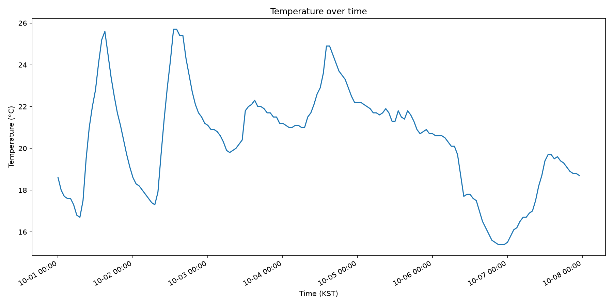
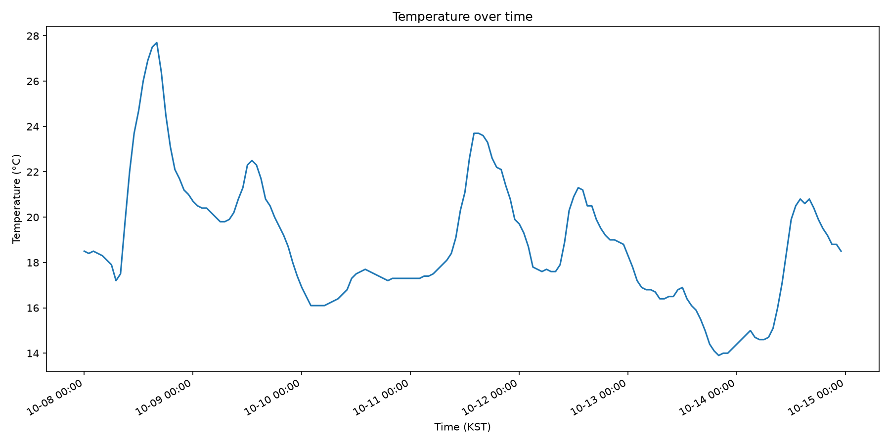
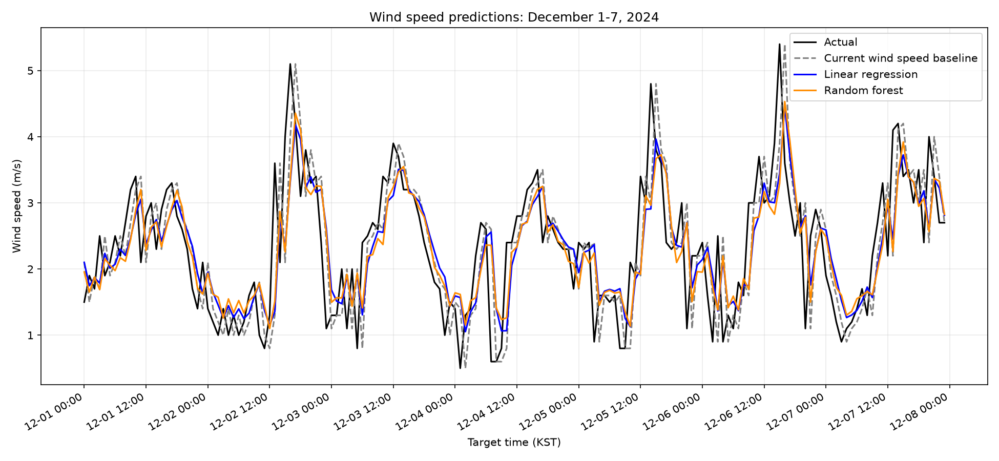

# 기상 관측 자료 수집 및 그래프

기상청 종관기상관측 자료를 수집·정리하고, 주간 시간별 기온 그래프를 만드는 Python 프로젝트입니다.

## 관측 정보 및 출처

- **자료 출처:** [기상청 API허브 - 지상 관측자료 조회 (`kma_sfctm3.php`)](https://apihub.kma.go.kr/api/typ01/url/kma_sfctm3.php)
- **관측소:** 108 (서울)
- **시간 기준:** KST, 매시 관측
- **수집 기간:** 1주차 2025-10-01 00:00~2025-10-07 23:00, 2주차 2025-10-08 00:00~2025-10-14 23:00
- **저장 항목:** 관측 시각, 기온(°C), 상대습도(%), 풍속(m/s)

`collect_weather.py`는 현재 2주차 기간으로 설정되어 있습니다. CSV의 첫째 주 자료는 기존 `weather.csv`에, 둘째 주 자료는 `weather_week2.csv`에 있습니다.

## 환경 설정

Python 3.10 이상을 사용하고 프로젝트 폴더에서 필요한 패키지를 설치합니다.

```powershell
python -m venv .venv
.\.venv\Scripts\Activate.ps1
python -m pip install -r requirements.txt
```

`requests`는 API 요청에, `matplotlib`은 그래프 작성에 사용됩니다.

## 파일 안내

| 파일 | 설명 |
|---|---|
| `collect_weather.py` | 기상청 API에서 관측 자료를 가져와 CSV로 저장합니다. 실행 중 인증키를 입력합니다. |
| `plot_weather.py` | 시간 자료를 정렬하고 누락된 시각과 기온 결측을 반영해 선 그래프를 저장하고 표시합니다. |
| `weather.csv` | 2025년 10월 1일 00시부터 10월 7일 23시까지의 시간별 자료입니다. |
| `temperature.png` | `weather.csv`를 사용해 생성한 그래프 이미지입니다. |
| `weather_week2.csv` | 2025년 10월 8일 00시부터 10월 14일 23시까지의 두 번째 주 시간별 자료입니다. |
| `temperature_week2.png` | `weather_week2.csv`를 사용해 생성한 두 번째 주 그래프 이미지입니다. |

CSV의 주요 열은 `datetime`, `temperature_C`, `humidity_pct`, `wind_speed_ms`입니다. 시간은 `YYYY-MM-DD HH:MM` 형식이며, 빈 기온값은 결측으로 취급합니다.

## 실행 방법

아래 명령은 프로젝트 폴더에서 실행합니다.

1. KMA API 인증키를 준비하고 자료를 수집합니다. 키는 실행 중 터미널에서 입력합니다.
```powershell
python collect_weather.py
```

현재 설정에서 응답 원문은 `weather_raw_week2.txt`, 정리된 CSV는 `weather_week2.csv`에 저장됩니다. 첫째 주 자료를 다시 수집하려면 스크립트의 시작·종료 시각과 출력 파일 이름을 해당 기간에 맞게 변경해야 합니다.

2. 현재 설정된 2주차 그래프를 생성합니다. 이미지 저장과 함께 그래프 창도 표시됩니다.
```powershell
python plot_weather.py
```

`plot_weather.py`는 `weather_week2.csv`에서 `temperature_week2.png`를 만듭니다. 첫째 주 `weather.csv`와 `temperature.png`는 기존 결과이며, 현재 스크립트 실행으로 덮어쓰지 않습니다.

## 누락 및 결측 확인

현재 폴더의 두 CSV를 확인한 결과, 각 기간은 168행이며 아래와 같습니다.

| 파일 | 시간 범위 | 기온 결측 | 습도 결측 | 풍속 결측 |
|---|---|---:|---:|---:|
| `weather.csv` | 2025-10-01 00:00~2025-10-07 23:00 | 0 | 0 | 0 |
| `weather_week2.csv` | 2025-10-08 00:00~2025-10-14 23:00 | 0 | 0 | 0 |

기록된 시각은 두 기간 모두 매시 자료이며, 결측 시각과 빈 기상값은 확인되지 않았습니다. 이후 결측 기온이 생기면 그래프의 해당 구간은 선이 끊겨 표시됩니다.

## 그래프 해석

1주차 평균 기온은 20.40°C, 2주차는 18.82°C로 2주차 평균이 1.58°C 낮았습니다.
다만 2주차 최고 기온은 27.7°C로 1주차(25.7°C)보다 높았고, 최저 기온은 13.9°C로 1주차(15.4°C)보다 낮아 주간 기온 범위가 더 넓었습니다.

## 그래프 미리보기

첫 번째 주:



두 번째 주:



## 풍속 예측 실험 (2023-2024)

`asos_108_2023_2024.csv`의 관측 자료로 `build_wind_dataset.ps1`을 실행하면 누락된 시각을 시간별 빈 행으로 간주해 입력·정답 쌍을 만들고, 필요한 값이 결측인 행은 제외하여 `wind_dataset.csv`를 생성합니다. 예측 입력은 현재 풍속·기온·습도와 1·2시간 전 풍속이며, 정답은 1시간 뒤 풍속입니다.

`train_wind_model.py`는 정답 시각 기준으로 2023년 1월부터 2024년 11월까지 학습하고, 2024년 12월 1~31일을 평가합니다. 시간순 분리를 유지하며 평가 중 재학습하지 않습니다. 랜덤포레스트 설정은 트리 100개, 최대 깊이 6, 리프 최소 표본 5개, `random_state=42`입니다. 세 방법의 예측은 `predictions.csv`에 저장됩니다.

```powershell
powershell -ExecutionPolicy Bypass -File .\build_wind_dataset.ps1
python train_wind_model.py
python plot_predictions.py
```

2024년 12월 평가 결과(744행):

| 방법 | MAE (m/s) |
|---|---:|
| 현재 풍속 유지 | 0.653495 |
| 선형회귀 | 0.594577 |
| 랜덤포레스트 | 0.593807 |

랜덤포레스트의 가장 큰 절대 오차는 **2024-12-30 12:00 KST**에 발생했습니다. 실제 풍속은 3.700 m/s였지만 현재 풍속 유지 예측은 0.500, 선형회귀는 0.948, 랜덤포레스트는 1.067 m/s로 각각 3.200, 2.752, 2.633 m/s 낮게 예측했습니다. 다음으로 큰 랜덤포레스트 오차는 **2024-12-18 23:00**으로, 실제 0.700 m/s에 비해 예측은 3.176 m/s였습니다(절대 오차 2.476 m/s). 이는 다음 시각의 급격한 풍속 변화를 현재와 직전 관측만으로 포착하기 어려운 사례입니다.

Copilot 작업 요청은 시간별 학습 자료 생성, 시간순 학습·12월 평가, 세 예측 방법 비교, 첫 주 그래프 생성이었습니다. 직접 실행해 16,720개 학습행과 744개 평가행, 12월 MAE, `random_state=42` 반복 실행 시 동일한 예측 파일을 확인했습니다. 그래프는 12월 1~7일 168개 평가행을 표시하며, MAE는 12월 전체 744행으로 계산합니다.


